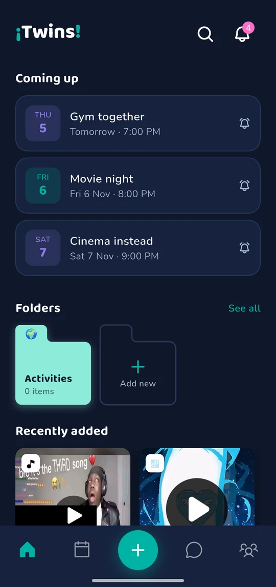
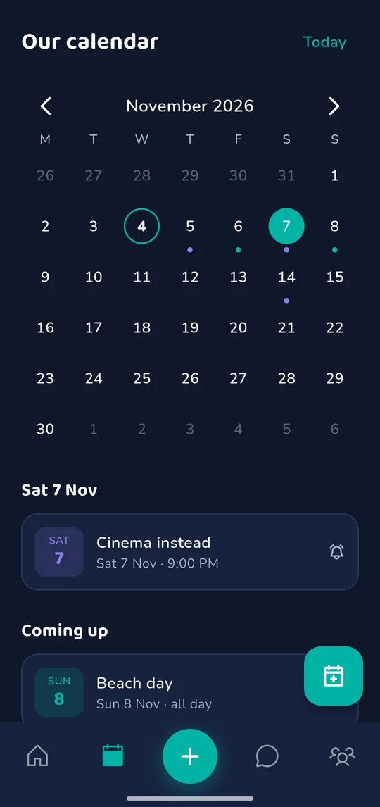
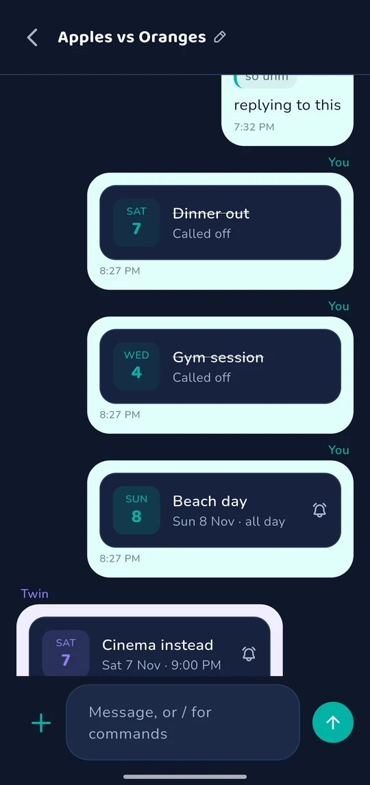
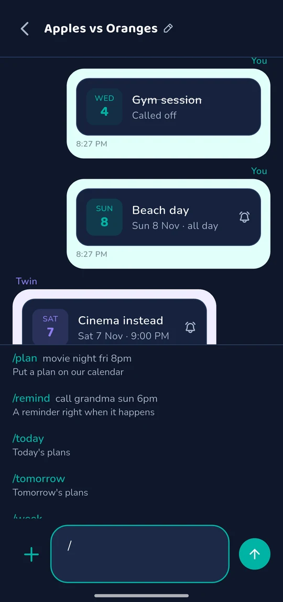
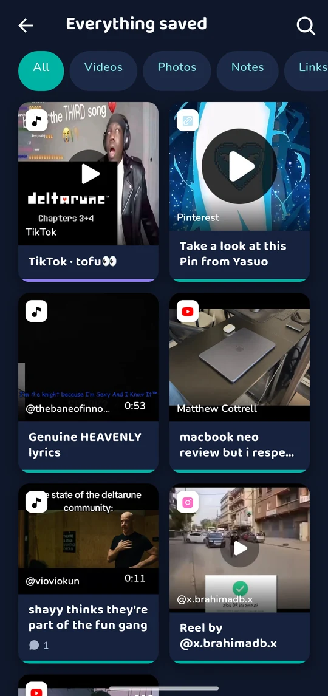
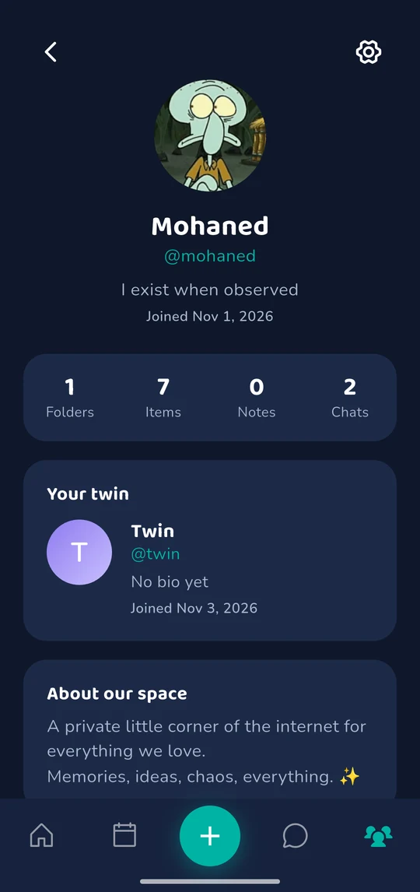
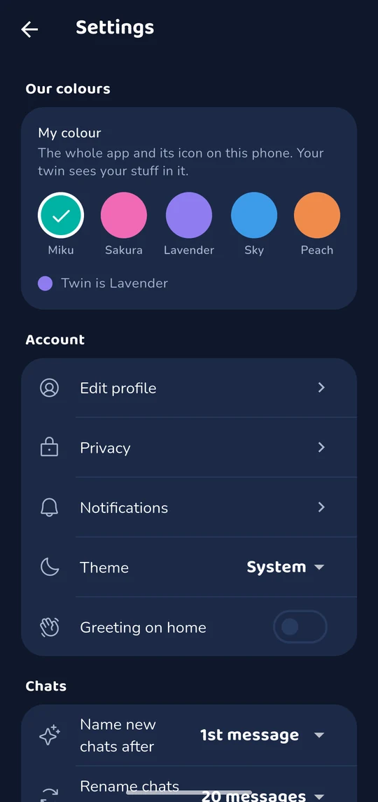

<h1>
  
  ¡Twins!
</h1>

A private shared digital space for exactly two people. Save reels, TikToks,
YouTube videos, links, notes, images, and files from anywhere on your phone
straight into one shared space with your person — organize it into folders,
react and comment on anything (including at a specific video timestamp), and
keep a lightweight running chat together.

Think: Pinterest + Discord threads + a private scrapbook + a shared drive,
built for exactly two people. Not a social network — no followers, no public
feed, no discovery.

## App pages

Screenshots from the app on a phone (v1.0.0). Green is one twin and lavender
the other: each picks their own colour, and everything they make shows in it.

| Home | Calendar |
| --- | --- |
|  |  |
| Plans in chat | Chat commands |
|  |  |
| Saved post | Everything saved |
|  |  |
| Profile | Our colours |
|  |  |

The original design mockups are in [design/](design/).

## Architecture

- **App**: Flutter (Dart), Riverpod for state, `go_router` for navigation.
- **Backend**: Supabase (Postgres + Auth + Storage + Realtime).
- **Data layer abstraction** (`lib/data/repositories/twins_repository.dart`):
  every screen talks to a single `TwinsRepository` interface. Two
  implementations exist:
  - `SupabaseTwinsRepository` (`lib/data/supabase/`) — the real backend, and
    the only one the app uses (`lib/state/repository_provider.dart`).
  - `MockTwinsRepository` (`lib/data/mock/`) — in-memory, seeded with demo
    data. Test-only: the widget and golden tests override
    `repositoryProvider` with it.
- **Edge Functions** (`supabase/functions/`): `resolve-link` builds link
  previews with per-platform extractors (YouTube, TikTok, Instagram, X, …)
  plus oEmbed/OpenGraph, keeps author/site/duration, and re-hosts thumbnails
  into Storage; `suggest-tags` and `name-chat` are the Groq-backed AI helpers.
  All AI calls run server-side only.
- **Migrations** (`supabase/migrations/`): full schema + Row Level Security
  policies + the secure `join_space_with_code` RPC.
- **Search** (`supabase/migrations/0009_search.sql`): a weighted `tsvector`
  over title/description/content/URL with a GIN index, a `pg_trgm` index for
  partial and misspelled words, and the `search_items()` RPC that ranks
  results and also matches tag and folder names. Per-user recent searches live
  in `search_history` (your own history only — your twin can't see it).

## Requirements

- Flutter 3.24+ (Dart 3.5+)
- Xcode (iOS) / Android Studio or just the Android SDK (Android)
- A Supabase project (required — the app has no offline/demo mode)

## Install

```bash
flutter pub get
```

## Running

```bash
flutter run
```

Each pair of twins runs ¡Twins! on **their own Supabase project** — the free
tier is plenty. On first launch the app walks through it:

1. **Connect** — paste the project URL and publishable key
   (Project Settings → API Keys). These are the only values kept on the phone.
2. **Set up the database** — only if the project is empty or older than this
   app. Paste the Session pooler connection string (Connect → Session pooler,
   with your DB password filled in); the app applies every bundled migration
   itself and records them where the Supabase CLI looks. Used once, never saved.
3. **Link previews & AI** (optional) — paste a Supabase personal access token
   and optionally a Groq key; the app deploys `resolve-link`, `suggest-tags`
   and `name-chat` through the Management API and sets `GROQ_API_KEY`. Skip it
   and links simply save without a preview.

The second twin's phone only needs step 1.

### Build modes

- **Normal** (`scripts/build_normal.ps1`, or plain `flutter build`): nothing
  baked in; the full setup flow above.
- **Special** (`scripts/build_special.ps1`): reads your local, git-ignored
  `.env` and bakes the URL and key in via `--dart-define`, so step 1 is
  skipped — for handing straight to your twin.

To populate a project with a demo pair ("Mohaned & Rania") and sample
folders/items, run the seed script described under "Supabase setup".

### Incoming OS share ("Share to ¡Twins!")

Sharing content **into** ¡Twins! from TikTok/Instagram/YouTube/a browser only
works from a real install on a device/emulator — `flutter run` in debug mode
is enough on Android. It does **not** work in an iOS Simulator without the
share extension target described in the iOS notes below, and it will never
work in a pure web/desktop preview.

To test on Android:

```bash
flutter run
# then, from any other app: Share -> ¡Twins!
```

## Supabase setup

The app's setup screen does all of this on its own (see "Running"). To do it
from a computer instead, see [docs/SUPABASE_SETUP.md](docs/SUPABASE_SETUP.md);
short version:

```bash
supabase link --project-ref <your-project-ref>
supabase db push                                # applies everything in supabase/migrations
supabase functions deploy resolve-link          # link enrichment (optional)
supabase functions deploy suggest-tags          # AI tag suggestions (optional)
supabase functions deploy name-chat             # AI chat auto-naming (optional)
supabase secrets set --env-file supabase/.env   # sets GROQ_API_KEY (optional, shared by all three)

# optional: load a realistic demo dataset (two paired users + content)
cd supabase && npm install && npm run seed
```

## Environment variables

Two files, split by trust level (see `.env.example` and
[docs/SUPABASE_SETUP.md](docs/SUPABASE_SETUP.md)):

**`.env`** (repo root, git-ignored; read only by `scripts/build_special.ps1`):

| Variable | Where it's used | Required? |
|---|---|---|
| `EXPO_PUBLIC_SUPABASE_URL` | Baked in as `SUPABASE_URL` by the special build | Special build only |
| `EXPO_PUBLIC_SUPABASE_PUBLISHABLE_KEY` | Baked in as `SUPABASE_PUBLISHABLE_KEY` by the special build | Special build only |

**`supabase/.env`** (git-ignored, never bundled — server-side secrets):

| Variable | Where it's used | Required? |
|---|---|---|
| `SUPABASE_SECRET_KEY` | `seed.ts`, off-device only | Only to run the seed |
| `SUPABASE_DB_PASSWORD` / `*_CONNECTION_STRING` | `psql` / `supabase db push` | Only for direct DB access |
| `GROQ_API_KEY` | `resolve-link`, `suggest-tags`, `name-chat` Edge Functions, server-side only | No (enables AI polish/tagging/naming) |

**Never** put `SUPABASE_SECRET_KEY`, the service-role JWT, the DB password, or
`GROQ_API_KEY` in the client `.env` — the secret key bypasses Row Level
Security and the app bundle is world-readable. All AI calls (link polish, tag
suggestion, chat naming) go through Edge Functions, so `GROQ_API_KEY` never
ships in the client.

## How pairing works

One Supabase project holds exactly one pair. Instead of emails and invite
codes, the project has two account **slots**
(`supabase/migrations/0014_twin_slots.sql`):

- **"Who's this?"** lists both slots before anyone logs in (`twin_slots()`):
  a taken slot shows that twin's name and avatar and asks for their password;
  an empty one offers "Create account" with just a name and a password.
- **Creating** calls `claim_twin_slot()`, which makes the auth user directly
  (login email `twin1@twins.local` / `twin2@twins.local`, so no confirmation
  mail or SMTP is ever involved). The first twin's claim creates the space;
  the second joins it.
- **Forgot password?** There's no recovery email: either twin sets a new
  password for the other in Settings → Privacy → "Reset a twin's password"
  (`reset_twin_password()`, members of the same space only).

The two-member cap is still enforced server-side (a trigger on
`space_members`), and every folder/item/comment/message/reaction is visible to
both and only both through Row Level Security
(`supabase/migrations/0004_row_level_security.sql`).

These guarantees are checked by `supabase/tests/pairing_rls_test.sql`: three
throwaway users act out create → invite → join and probe the cap, single-use
and expired invites, and cross-space reads/writes. It runs inside one
transaction that always rolls back, so it is safe against the live project:

```bash
psql "$SUPABASE_POOLER_CONNECTION_STRING" -v ON_ERROR_STOP=1 -f supabase/tests/pairing_rls_test.sql
```

## Calendar and chat commands

- **Calendar tab** (`events`, migration 0018): shared plans with a time or
  all day, optional end, notes, a linked saved item and a reminder. Both
  twins see and edit everything; calling a plan off keeps it (struck
  through) so it can be brought back.
- **Reminders** are alarms on each phone (`flutter_local_notifications`),
  kept in line with the calendar while the app runs and set from the plan's
  push when it's closed: nothing on the server runs on a timer.
- **Chat**: swipe a message to reply. Commands: `/plan <what> <when>`,
  `/remind`, `/today`, `/tomorrow`, `/week`, `/next`, `/cancel`, `/help`.
  `<when>` understands things like `fri 8pm`, `tomorrow at 8`, `12/11`,
  `nov 20th`, `8-11pm`, `in 2 hours`; add `!30m` / `!1h` / `!1d` for a
  reminder or `!no` for none.

## Colours

Each twin picks a colour in Settings → Our colours (`profiles.theme_color`,
migration 0020; the list is `lib/theme/twin_color.dart`). It recolours the
whole app on their phone and switches the launcher icon (an
`activity-alias` per colour, toggled from `MainActivity`). Everything a twin
makes (messages, plans, comments, saved items) is drawn in their colour on
both phones.

## Folders, selection and settings

- An item can be in **several folders** (`items.folder_ids`, migration 0015).
  Item details → Add to folder, the add screen's folder chips, and
  long-press multi-select (home and folder views) all use the same checkbox
  sheet.
- **Settings** (per phone): theme, greeting on home, when new chats get
  auto-named (1st/2nd/3rd message), which images the AI looks at
  (thumbnail / YouTube start, middle, end frames), and **Update server
  functions**, which redeploys the edge functions with a personal access
  token after an app update changes them. **Clear data** wipes saved
  items, folder contents, chats or everything (migration 0019).

## How incoming share works

`lib/sharing/share_intent_service.dart` wraps the `receive_sharing_intent`
plugin. On Android, `android/app/src/main/AndroidManifest.xml` registers an
`ACTION_SEND` intent filter for `text/*`, so any share sheet showing "¡Twins!"
as a target hands off a URL/text string, which gets routed straight into
`/add` pre-filled. If the user isn't logged in yet, the payload is cached via
`SharedPreferences` and replayed the moment they land on the home shell.

## How link metadata works

When a URL is pasted into "Add item", the client immediately guesses the
type (YouTube/TikTok/Instagram/generic link) from the URL shape
(`lib/utils/link_detector.dart`) so the UI can show the right icon right
away, then calls the `resolve-link` Edge Function in the background to fetch
a real title/description/thumbnail. If that call fails or Supabase isn't
configured, the user can still save the raw URL — enrichment is always
best-effort and never blocks saving.

## How Groq enrichment works

Entirely optional. If `GROQ_API_KEY` is set as an Edge Function secret,
`resolve-link` asks Groq (`openai/gpt-oss-20b`, or `qwen/qwen3.8-27b` with up to three images when AI vision is on) to turn the raw
oEmbed/OpenGraph title+description into a shorter, punchier title, a
one-sentence summary, and 2-4 suggested tags. If the key is missing or the
call fails for any reason, the function silently falls back to the raw
metadata — the app never depends on AI being available.

## Android notes

- Fully supported, including incoming share (`ACTION_SEND`).
- Direct Share: once you're in a space, the app publishes a long-lived
  sharing shortcut named after it (`MainActivity.kt`, `res/xml/shortcuts.xml`),
  so it can appear in the system share sheet's top row. Apps with their own
  share panels (TikTok, Instagram) still list it under "More" — those rows
  are curated by the apps themselves.
- Package: `com.mohaned.twins`.

## iOS notes

- Auth, folders, items, chat, comments, reactions, uploads, and link
  metadata all work identically to Android.
- **Incoming share requires one manual Xcode step** this repo can't
  automate headlessly: add a "Share Extension" target in Xcode
  (File → New → Target → Share Extension), add both the main app target and
  the new extension to the same App Group, and follow the
  `receive_sharing_intent` package's iOS setup guide for wiring the
  extension's `ShareViewController` and `Info.plist` `NSExtensionActivationRule`.
  Until that's done, iOS builds run fully otherwise — you just can't
  "Share → ¡Twins!" from other iOS apps yet.

## Known limitations

- TikTok/Instagram Reels are **not** re-hosted or downloaded — per platform
  ToS, the item detail screen shows the thumbnail/title/metadata and an
  "Open original" button rather than embedding playback. This is a
  deliberate scope boundary, not a missing feature.
- The iOS share extension needs the one-time manual Xcode step above.
- Push notifications are not wired up (no APNs/FCM credentials configured);
  the app relies on Supabase Realtime for in-app live updates instead. The
  architecture (`TwinsRepository` streams) is ready for push to be added
  later without restructuring.
- Profile avatar upload is wired to Supabase Storage's `avatars` bucket
  (`supabase/migrations/0006_storage.sql`), alongside display name/username/bio
  editing.
- Import from a backup (Settings → Our Space) re-creates folders and items
  from a JSON export into the current space, alongside Export.
