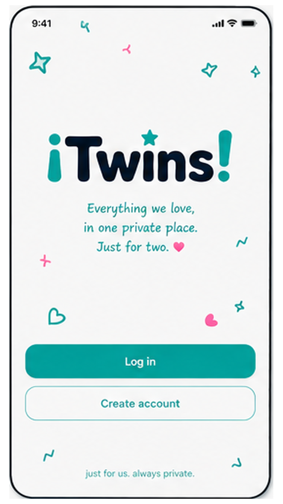
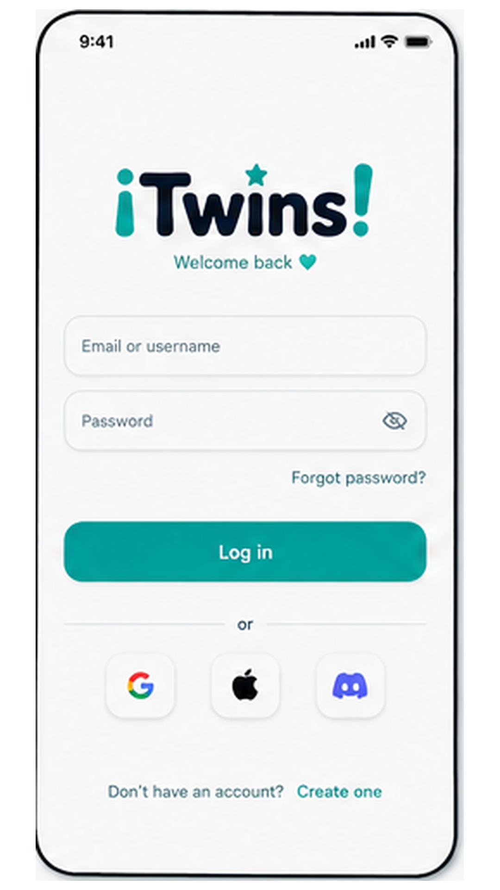
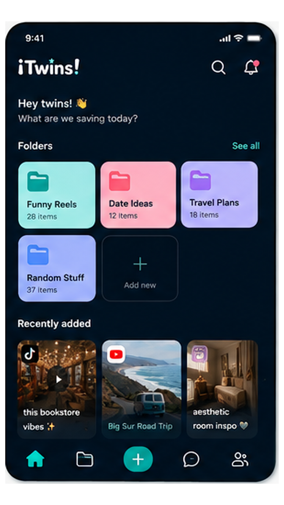
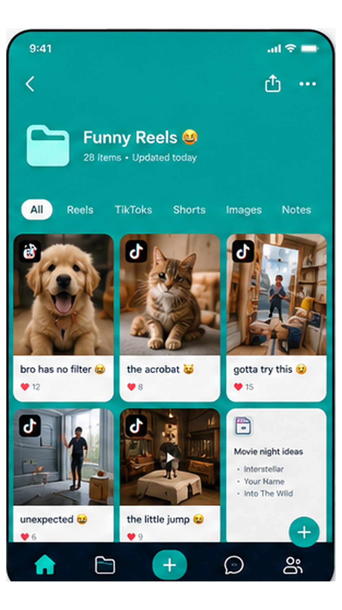
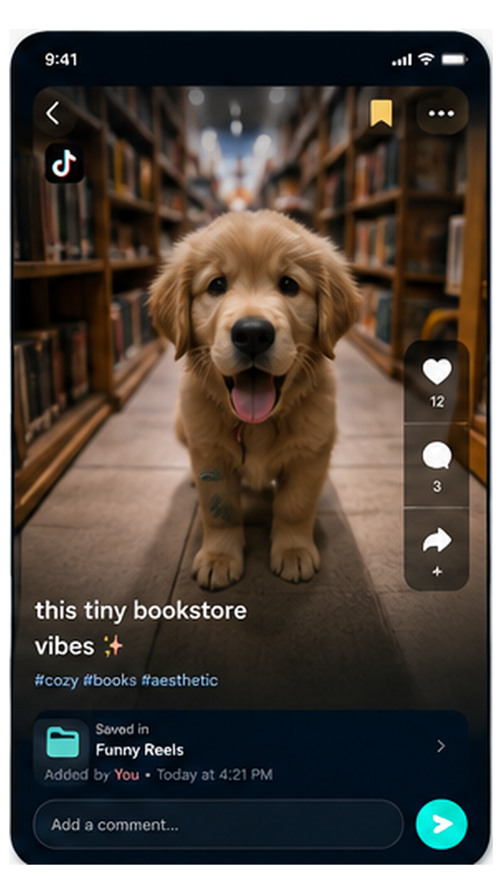
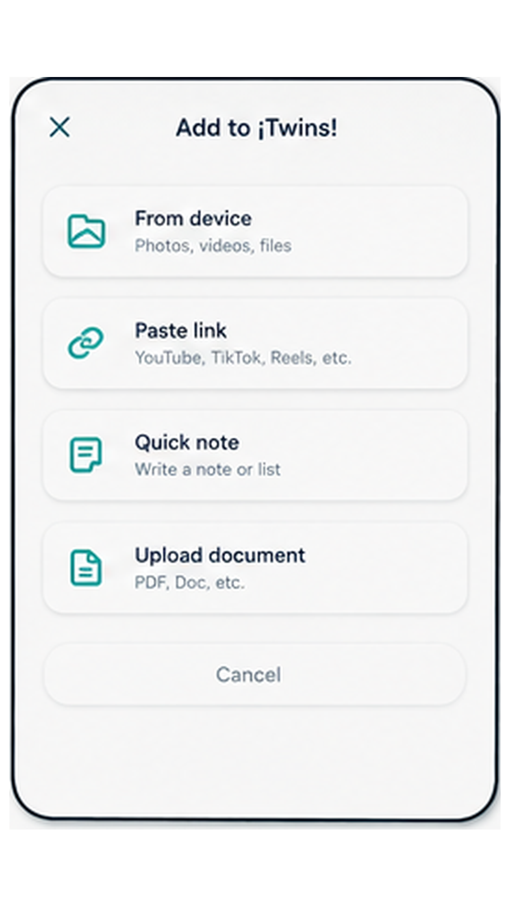
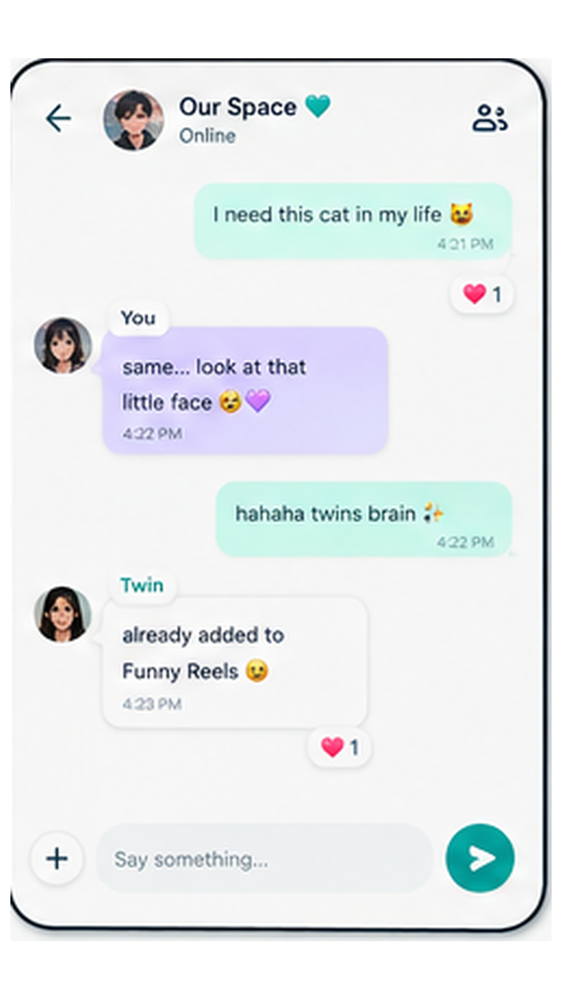
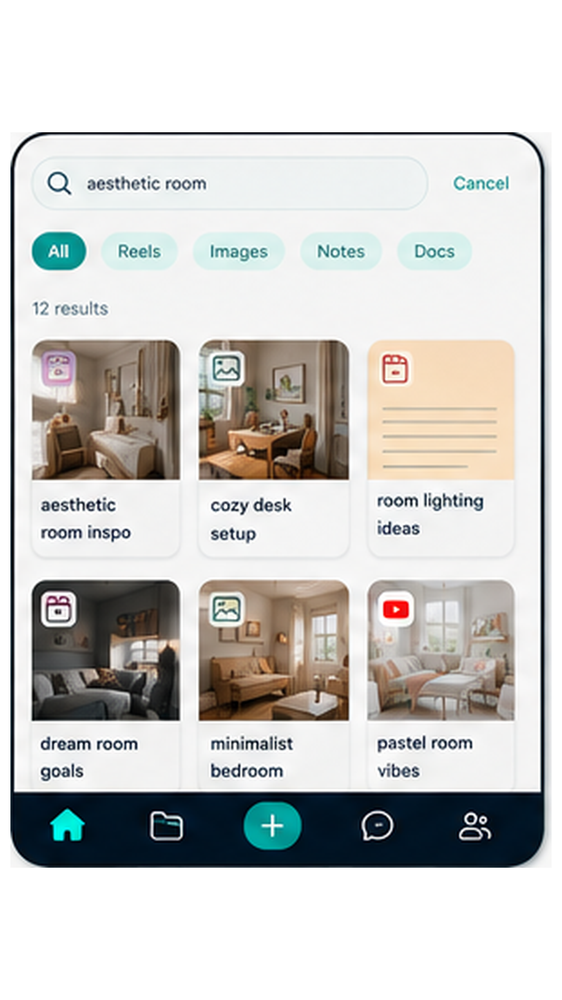
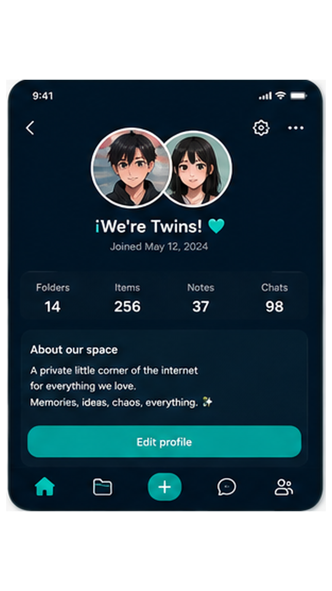
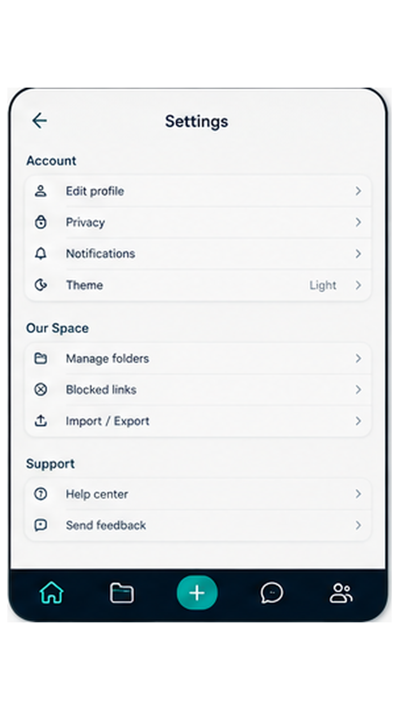

<h1>
  
  ¡Twins!
</h1>

A private shared digital space for exactly two people. Save reels, TikToks,
YouTube videos, links, notes, images, and files from anywhere on your phone
straight into one shared space with your person — organize it into folders,
react and comment on anything (including at a specific video timestamp), and
keep a lightweight running chat together.

Think: Pinterest + Discord threads + a private scrapbook + a shared drive,
built for exactly two people. Not a social network — no followers, no public
feed, no discovery.

## App pages

| Welcome | Login |
| --- | --- |
|  |  |
| Home dashboard | Folder view |
|  |  |
| Item detail | Add item |
|  |  |
| Chat | Search & explore |
|  |  |
| Profile | Settings |
|  |  |

## Architecture

- **App**: Flutter (Dart), Riverpod for state, `go_router` for navigation.
- **Backend**: Supabase (Postgres + Auth + Storage + Realtime).
- **Data layer abstraction** (`lib/data/repositories/twins_repository.dart`):
  every screen talks to a single `TwinsRepository` interface. Two
  implementations exist:
  - `SupabaseTwinsRepository` (`lib/data/supabase/`) — the real backend, and
    the only one the app uses (`lib/state/repository_provider.dart`).
  - `MockTwinsRepository` (`lib/data/mock/`) — in-memory, seeded with demo
    data. Test-only: the widget and golden tests override
    `repositoryProvider` with it.
- **Edge Functions** (`supabase/functions/`): `resolve-link` builds link
  previews with per-platform extractors (YouTube, TikTok, Instagram, X, …)
  plus oEmbed/OpenGraph, keeps author/site/duration, and re-hosts thumbnails
  into Storage; `suggest-tags` and `name-chat` are the Groq-backed AI helpers.
  All AI calls run server-side only.
- **Migrations** (`supabase/migrations/`): full schema + Row Level Security
  policies + the secure `join_space_with_code` RPC.
- **Search** (`supabase/migrations/0009_search.sql`): a weighted `tsvector`
  over title/description/content/URL with a GIN index, a `pg_trgm` index for
  partial and misspelled words, and the `search_items()` RPC that ranks
  results and also matches tag and folder names. Per-user recent searches live
  in `search_history` (your own history only — your twin can't see it).

## Requirements

- Flutter 3.24+ (Dart 3.5+)
- Xcode (iOS) / Android Studio or just the Android SDK (Android)
- A Supabase project (required — the app has no offline/demo mode)

## Install

```bash
flutter pub get
```

## Running

```bash
flutter run
```

A plain `flutter run`/`flutter build` has no project baked in: on first launch
the app shows a setup screen asking for your Supabase project URL and
publishable key, then caches them on the device.

### Build modes

- **Normal** (`scripts/build_normal.ps1`, or plain `flutter build`): nothing
  baked in; first-launch setup screen as above.
- **Special** (`scripts/build_special.ps1`): reads your local, git-ignored
  `.env` and bakes the URL and key in via `--dart-define`, so the APK just
  works — for handing straight to your twin.

To populate a project with a demo pair ("Mohaned & Rania") and sample
folders/items, run the seed script described under "Supabase setup".

### Incoming OS share ("Share to ¡Twins!")

Sharing content **into** ¡Twins! from TikTok/Instagram/YouTube/a browser only
works from a real install on a device/emulator — `flutter run` in debug mode
is enough on Android. It does **not** work in an iOS Simulator without the
share extension target described in the iOS notes below, and it will never
work in a pure web/desktop preview.

To test on Android:

```bash
flutter run
# then, from any other app: Share -> ¡Twins!
```

## Supabase setup

Full step-by-step instructions (create project, run migrations, configure
storage, deploy the Edge Functions, set the optional Groq secret) live in
[docs/SUPABASE_SETUP.md](docs/SUPABASE_SETUP.md).

Short version:

```bash
supabase link --project-ref <your-project-ref>
supabase db push                                # applies everything in supabase/migrations
supabase functions deploy resolve-link          # link enrichment (optional)
supabase functions deploy suggest-tags          # AI tag suggestions (optional)
supabase functions deploy name-chat             # AI chat auto-naming (optional)
supabase secrets set --env-file supabase/.env   # sets GROQ_API_KEY (optional, shared by all three)

# optional: load a realistic demo dataset (two paired users + content)
cd supabase && npm install && npm run seed
```

## Environment variables

Two files, split by trust level (see `.env.example` and
[docs/SUPABASE_SETUP.md](docs/SUPABASE_SETUP.md)):

**`.env`** (repo root, git-ignored; read only by `scripts/build_special.ps1`):

| Variable | Where it's used | Required? |
|---|---|---|
| `EXPO_PUBLIC_SUPABASE_URL` | Baked in as `SUPABASE_URL` by the special build | Special build only |
| `EXPO_PUBLIC_SUPABASE_PUBLISHABLE_KEY` | Baked in as `SUPABASE_PUBLISHABLE_KEY` by the special build | Special build only |

**`supabase/.env`** (git-ignored, never bundled — server-side secrets):

| Variable | Where it's used | Required? |
|---|---|---|
| `SUPABASE_SECRET_KEY` | `seed.ts`, off-device only | Only to run the seed |
| `SUPABASE_DB_PASSWORD` / `*_CONNECTION_STRING` | `psql` / `supabase db push` | Only for direct DB access |
| `GROQ_API_KEY` | `resolve-link`, `suggest-tags`, `name-chat` Edge Functions, server-side only | No (enables AI polish/tagging/naming) |

**Never** put `SUPABASE_SECRET_KEY`, the service-role JWT, the DB password, or
`GROQ_API_KEY` in the client `.env` — the secret key bypasses Row Level
Security and the app bundle is world-readable. All AI calls (link polish, tag
suggestion, chat naming) go through Edge Functions, so `GROQ_API_KEY` never
ships in the client.

## How pairing works

A "Twins space" has a hard cap of exactly two members, enforced **server-side**
(a Postgres trigger on `space_members`, plus the `join_space_with_code` RPC
re-checking the count) — never trust a client-side check for this. After
signing up, a user either:

1. **Creates a space** — generates a 6-character invite code (e.g. `7HG2K9`)
   that expires in 7 days.
2. **Joins with a code** — calls the `join_space_with_code(invite_code)` RPC,
   which validates the code, checks the 2-member cap, and inserts the
   membership row atomically.

Once both people are in, every folder/item/comment/message/reaction is
visible to both and only both, enforced by Row Level Security
(`supabase/migrations/0004_row_level_security.sql`).

## How incoming share works

`lib/sharing/share_intent_service.dart` wraps the `receive_sharing_intent`
plugin. On Android, `android/app/src/main/AndroidManifest.xml` registers an
`ACTION_SEND` intent filter for `text/*`, so any share sheet showing "¡Twins!"
as a target hands off a URL/text string, which gets routed straight into
`/add` pre-filled. If the user isn't logged in yet, the payload is cached via
`SharedPreferences` and replayed the moment they land on the home shell.

## How link metadata works

When a URL is pasted into "Add item", the client immediately guesses the
type (YouTube/TikTok/Instagram/generic link) from the URL shape
(`lib/utils/link_detector.dart`) so the UI can show the right icon right
away, then calls the `resolve-link` Edge Function in the background to fetch
a real title/description/thumbnail. If that call fails or Supabase isn't
configured, the user can still save the raw URL — enrichment is always
best-effort and never blocks saving.

## How Groq enrichment works

Entirely optional. If `GROQ_API_KEY` is set as an Edge Function secret,
`resolve-link` asks Groq (`llama-3.1-8b-instant`) to turn the raw
oEmbed/OpenGraph title+description into a shorter, punchier title, a
one-sentence summary, and 2-4 suggested tags. If the key is missing or the
call fails for any reason, the function silently falls back to the raw
metadata — the app never depends on AI being available.

## Android notes

- Fully supported, including incoming share (`ACTION_SEND`).
- Package: `com.mohaned.twins`.

## iOS notes

- Auth, folders, items, chat, comments, reactions, uploads, and link
  metadata all work identically to Android.
- **Incoming share requires one manual Xcode step** this repo can't
  automate headlessly: add a "Share Extension" target in Xcode
  (File → New → Target → Share Extension), add both the main app target and
  the new extension to the same App Group, and follow the
  `receive_sharing_intent` package's iOS setup guide for wiring the
  extension's `ShareViewController` and `Info.plist` `NSExtensionActivationRule`.
  Until that's done, iOS builds run fully otherwise — you just can't
  "Share → ¡Twins!" from other iOS apps yet.

## Known limitations

- TikTok/Instagram Reels are **not** re-hosted or downloaded — per platform
  ToS, the item detail screen shows the thumbnail/title/metadata and an
  "Open original" button rather than embedding playback. This is a
  deliberate scope boundary, not a missing feature.
- The iOS share extension needs the one-time manual Xcode step above.
- Push notifications are not wired up (no APNs/FCM credentials configured);
  the app relies on Supabase Realtime for in-app live updates instead. The
  architecture (`TwinsRepository` streams) is ready for push to be added
  later without restructuring.
- Profile avatar upload is wired to Supabase Storage's `avatars` bucket
  (`supabase/migrations/0006_storage.sql`), alongside display name/username/bio
  editing.
- Import from a backup (Settings → Our Space) re-creates folders and items
  from a JSON export into the current space, alongside Export.
